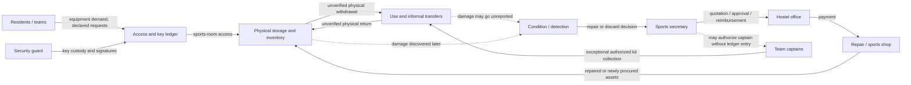
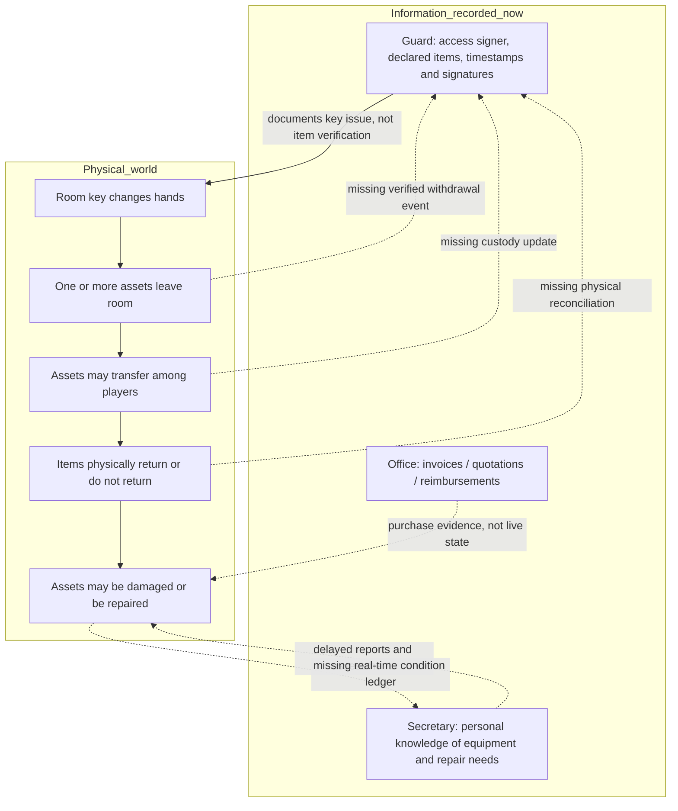

# B1 — Functional and Systems Decomposition

**Project:** Beyond the Game | **Primary site:** Alaknanda Hostel, IIT Madras  
**Status:** Analytical draft, based on Phase A sports-secretary testimony; physical and multi-stakeholder validation outstanding.  
**Scope:** Whole asset lifecycle; excludes changes to institutional spending authority.  
**Source:** [A4 executive synthesis](../research/phase-a/a4-executive-synthesis.md), [A2 process maps](../research/phase-a/a2-current-state-process-maps.md), [A4 evidence register/gaps](../research/phase-a/a4-evidence-gaps-and-validation.md).

## 1. Purpose and performance criterion

**Essential function:** Make suitable hostel-owned sports equipment accessible to authorized residents when needed, preserve its serviceable condition, and ensure manageable responsibility, repair and replenishment without disproportionate paperwork.

**Approved primary measure:** *Strict verified equipment accountability* = items with **independently correct recorded location + accountable custodian/entity + usable-condition state** / all audited eligible individually trackable items. No measured rate yet. It is inappropriate to report 0% just because the register lacks item IDs.

**Secondary outcomes:** Request fulfilment, recorded-versus-physical discrepancies, time to issue/return, maintenance lead time, stock availability, cost and administrator/student effort. The approximate five-minute collection time, 80:20 condition split and 20–22 weekly sport-use sessions are **unverified estimates/scenarios**, not observed baselines.

## 2. System boundary and interfaces

**In scope:** hostel-owned equipment and kits; sports-room physical storage; resident demand; room-key custody; paper declaration register; informal handovers; equipment use/return/condition; sports secretary's inspection, repair, discard and purchasing; hostel office authorizations; external repair and sports shops; tournament exceptions.

**External influences:** weather, match schedule, hostel budgets, availability of repair vendors, hostels' financial policy and users' care of equipment. We record these as inputs/constraints rather than pretending to control them.

**Actors:** resident/borrower; team captain; on-ground subsequent user; security guard (key/ID/register only); sports secretary (purchase, repair, discard); hostel office (payments/reimbursements and funding decisions); external shop (quotes, repairs and supply). The physical item may change hands without a corresponding change of key custodian.

**Critical distinction:** Access authorization is **not** evidence that a specified individual asset was withdrawn, held, returned or inspected.

## 3. Functional architecture

| ID | Essential function | Inputs | Outputs | Current operator or mechanism | Failure opportunity / evidence status |
| --- | --- | --- | --- | --- | --- |
| F01 | Define demand and eligibility | Sport, user, activity | Borrowing need and access permission | Hostel residence, guard access | Availability not independently known (reported) |
| F02 | Grant physical access | ID card, key, register signature | Key handed to signer | Guard | Other users may access during outstanding key loan (reported; mechanics unclear) |
| F03 | Locate and select assets | Intended equipment, sports room | Physical item(s) removed | Student self-service | No item-level or quantity verification (reported); finding items generally easy |
| F04 | Establish custody | Borrower, items, handover event | Responsible person/team and time | Declared paper register only | Item custody cannot be inferred reliably from key custodian (reported) |
| F05 | Support play and transfer | Assets, players, grounds | Use, possible handovers | Players | Informal on-ground and later-away transfers not logged (reported) |
| F06 | Accept return and reconcile | Returned key, student declaration, physical items | Restored stock and closed borrow | Guard returns ID and records claimed return | Return quantities and conditions not checked (reported) |
| F07 | Assess condition | Physical asset, damage cues | Usable / repair / discard decision | Usually sports secretary after delayed report | Damaged items mixed in usable storage; timing unknown (reported) |
| F08 | Repair / retire | Condition assessment, quotes, budget | Repaired or retired equipment | Secretary, shop, office | 3–7 day typical repair time is a recalled range; drivers mixed |
| F09 | Plan replenishment | Demand, current possessions, bills, funds | Proposed purchase and budget | Secretary and office | No verified live asset-condition inventory (reported) |
| F10 | Procure and add stock | Quotes, approvals, money | Purchased assets and bills | Secretary, hostel office, vendor | Threshold is reported local practice; verify against policy |
| F11 | Support team-level borrowing | Captain, kit, tournament approval | Kit in use and later returned | Captain + secretary | Some captain handovers have no register record, deliberately limiting match-day friction |
| F12 | Retain information history | Register, bills, possible messages | Audit / decision information | Paper register and bills | No reconciled item-level event history (reported) |

## 4. Distinct real-world entities (do not conflate)

| Entity | What it represents | Important properties | Common category error |
| --- | --- | --- | --- |
| Facility | Hostel sports room or future facility | Authorized access rules | Treating all hostels as identical without independent observation |
| Asset instance | One durable bat/racket/helmet/etc. | Physical ID (future), type, condition, location | Treating model or category as a unique physical unit |
| Stock lot | Fungible low-value units | Category, unit, quantity, condition | Requiring QR tracking per shuttlecock |
| Kit / bundle | Collection of distinct assets and stock quantities | Kit ID, component manifest, custodian | Assuming kit return means all components returned |
| Access event | Guard issues/receives a key | Key signer, issue/return time | Treating key return as item return |
| Declared borrowing | Student's intended items in register | Description, claimed quantities | Treating declarations as verified withdrawals |
| Physical handover | Item transfers from one holder to another | Asset(s), from/to, time | Inferring transfer from unrelated key records |
| Condition assessment | Determination of asset usability | Inspector, result, timestamp | Treating no complaint as evidence of good condition |
| Damage event | Suspected or identified damage | Description, discovery time, unknown occurrence time | Assigning damage to last named key signer |
| Maintenance case | Repair/replace workflow | Owner, shop, status, start/end | Mistaking identified damage for completed repair |
| Procurement case | Proposed expenditure and purchase | Threshold route, quotes, approvals, bill | Equating bill with current live inventory |

**Fact vs future schema:** IDs, verified handover events and systematic condition assessments in this table are **desired modeling constructs**, not processes present at Alaknanda today.

## 5. Information flow versus physical flow

**Information-loss boundaries:** (1) declaration → actual withdrawal, (2) individual handover → next custodian, (3) key/check-out return → actual item return, (4) damage occurrence → discovery/report, (5) invoice → live usable stock, (6) kit-level sign-out → component accountability.

## 6. Scope rules and deliberate constraints

- Existing 24/7 access and student independence must remain feasible; do **not** require sports secretary to approve every routine issue.
- Low match-day overhead is a real user requirement. Tournament permission without paperwork is a reported exception, **not** a practice to erase without alternatives.
- A verified chain of custody is a **future candidate goal**, not a claim that students are causing damage.
- Treat equipment and room key as two distinct custody objects.
- Use item-level tracking for durable assets, kit-manifest tracking for bundled equipment and quantity-level accounting for consumables; choice subject to Phase C experiments.
- Never assume that an app solves physical misuse, delayed reporting or funding constraints on its own.

## 7. Decision gate into B2

B1 does **not** select a QR solution, assign responsibility for historical damage, or invent observed event counts. B2 should test causal chains for information desynchronization, reporting delay and unauthorized state transitions, including friction and privacy trade-offs. B3 should demonstrate at least two quantitative transformers with source, operation, design consequence and validation approach.
