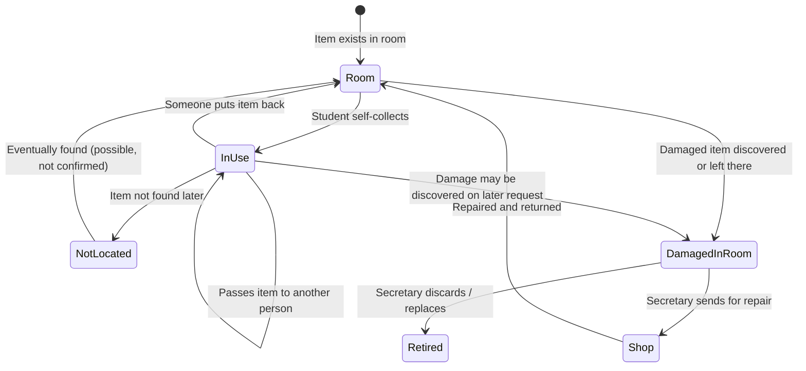

# B1 — State, Custody and Exception Model

**Status:** Conceptual current-state model + separately marked proposed invariants. No actual inventory census, operational telemetry or endorsed implementation architecture exists yet.

## 1. Model three independent dimensions

1. **Physical location** — in sports room, on ground, with student/team, at repair shop, elsewhere, unknown.
2. **Physical custody / accountable entity** — resident, team/captain, hostel storage, repair vendor, unknown. *Do not equate this with the person currently holding the access key.*
3. **Condition** — usable, damaged, requires inspection, repair in progress, retired, unknown.

A fourth independent dimension is **information confidence**: reported, verified at a time, inferred, missing, or stale. A recorded status can be wrong even when it looks complete.

A typical item's **true state** is represented by:

\[S_t=(L_t,C_t,Q_t)\]

where L is location, C is custody, Q is condition; the **recorded state** is \[\hat S_t=(\hat L_t,\hat C_t,\hat Q_t)\]. The gap between them is measured, not assumed. Evidence timestamps matter: a correct verification at 10:00 cannot guarantee correctness after a transfer at 10:05.

## 2. Existing flows (reported, no systematic item-level event log)



Diagram nodes are **physical situations**, not recorded register states; possible transitions do not imply observed frequency. The timing and cause of damage are often unknown.

## 3. Access-control state is independent

```mermaid
stateDiagram-v2
    [*] --> GuardHasKey
    GuardHasKey --> KeyCheckedOut: Student signs, gives ID
    KeyCheckedOut --> GuardHasKey: Same signer returns key, guard returns ID
    KeyCheckedOut --> SharedRoomAccess: Other students can access room
    SharedRoomAccess --> KeyCheckedOut: Access ends; initial key sign-out remains
```

The mechanism by which additional students access the room while the key is out is not yet established; this conceptual node should not be treated as a physical access procedure.

## 4. Future state-machine requirements to evaluate (NOT current policy)

| Operation | Proposed precondition | Proposed recorded effect | Risk it controls |
| --- | --- | --- | --- |
| Register asset | Unregistered equipment verified in stock | Asset has unique ID/category/location/condition | Duplicate or uncounted durable items |
| Issue item | Authorized user; item available and usable | Item unavailable to other requests; custody event recorded | Double issue and ambiguity |
| Transfer custody | Current accountable entity and recipient identified | Accountable custodian changes without changing item identity | Off-ground handover gap |
| Return item | Active custody / exception reconciled | Pending-inspection state, not automatically usable | Unverified returns |
| Pass condition check | Item physically examined | Available/usable with timestamp and examiner | Damaged items shown as usable |
| Fail condition check | Damage or uncertainty recorded | Quarantined / unavailable; maintenance case | Unsafe or unusable reissue |
| Repair completed | Maintenance work and inspection done | Usable state restored or item retired | Premature return to circulation |
| Issue kit | Manifest checked against physically collected components | Linked kit + component custody event | Missing kit components |
| Consume stock | Measured quantity withdrawal | Decrement stock-lot quantity | Item-level overhead for consumables |
| Retire asset | Authorized discard decision | Permanently out of active stock; reason logged | Phantom availability |

**Proposed invariants, subject to user and stakeholder approval**

- Every durable physical asset has at most one **current accountable custody assignment** in the redesigned ledger.
- A durable asset cannot have two active physical issue records at once.
- Condition != verified usable implies it cannot be shown as available for ordinary issue.
- Recorded loan completion requires item reconciliation; return of room key alone is insufficient.
- A kit is accountable at both manifest and constituent-item levels (or explicitly documented stock quantities).
- Damaged, missing, retired and repair-shop assets are not counted as available.
- All state-changing actions carry timestamp, actor/role and source of verification, with an exception procedure for offline use.
- Personal information is protected; public research outputs remain anonymized.

These are *candidate design rules*, not obligations to turn a guard into a full-time stock inspector. Phase C must test the overhead and choose a proportionate control mechanism.

## 5. Key edge cases for B2/B3/C

| Case | Current-state challenge | Future behavior to explore |
| --- | --- | --- |
| Shared room access | One checked-out key, several borrowers | Distinct access and item custody logs |
| On-ground item sharing | High-frequency casual transfers | Team-based responsibility or lightweight transfer mechanism |
| Off-ground handover | Initial signer may not be later holder | Optional confirmation with identifiable accountable group |
| Tournament kit | Secretary may skip register for speed | Pre-authorized kit reservation + rapid checkout / post-match reconciliation |
| Return claimed but missing | Register closed without physical verification | Explicit exception state and reconciliation, never presume theft |
| Damaged bat discovered later | Damage time unknown | Record discovery, not speculative damage occurrence or culprit |
| Damaged item in shared rack | Usability not marked | Quarantine tag/status until condition review |
| Consumable stock | Items lack individual identity | Lot accounting with quantity tolerance and audit |
| Repair at outside shop | Equipment not physically present | External custody/location recorded |
| Two simultaneous claims | Same equipment can be promised to several | Transactional allocation rules |
| Power/network failure | No digital update possible | Clearly bounded, auditable manual fallback |

## 6. Measurement link

The approved strict accountability metric tests agreement of **recorded** location, custody and condition with a contemporaneous independent check. For cases where the current record lacks item identity or a required dimension, score as **not fully verified** without inventing an incorrect value. Accompany the strict KPI with separate documentation of unknown and contradicted fields, and publish sampling limitations.

**Immediate next step:** B2 causal model with branching hypotheses and counterfactual tests; guard and player confirmation can follow without blocking theoretical analysis.
