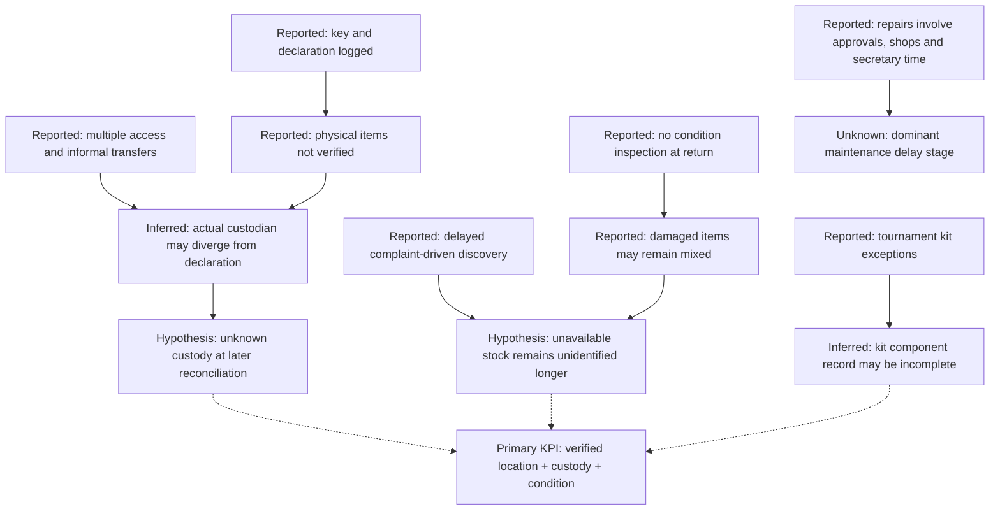

# B2 — Causal Analysis and Five Whys

**Project:** Beyond the Game — Alaknanda Hostel, IIT Madras  
**Status:** Causal **hypotheses** grounded in the sports secretary's Phase A testimony; not experimentally demonstrated.  
**Approval status:** Analysis may inform B3 and Phase C concepts; no operational changes or blame assigned to particular borrowers.

## Decision question

Why can the current access-register process fail to maintain reliable information about **which equipment is where, who is accountable for it, and whether it is usable**, even when it successfully controls a sports-room key?

The primary metric agreed in A3 is *strict verified equipment accountability*: the proportion of audited, individually trackable items for which the recorded **location, responsible custodian/entity, and condition** all match an independent contemporaneous check. **No actual percentage has been measured.** The key's sign-out record must not be confused with a verified equipment record. See [B1 state model](b1-state-and-custody-model.md) and [A3 protocol](../research/phase-a/a3-accountability-audit-protocol.md).

### Reading guide
- **[R]** Reported current process/incident from sports secretary, referenced to the A1 evidence register.
- **[I]** Logical inference from that process; not evidence of a frequency, individual fault, or outcome.
- **[H]** A specific causal hypothesis requiring a test.
- **[U]** Unknown or unmeasured.
- **[D]** Proposed design implication, not yet selected or implemented.

A Five Whys chain is a *structured causal explanation to test*. It is not a substitute for independent checks; questions need not end at exactly five steps. Multiple competing causes can exist.

---

## Chain 1 — Unverifiable equipment custody (priority 1)

**Problem statement:** When an item is claimed to be returned or is later not located, the current register cannot reliably reconstruct item-specific custody history. The missing badminton racket is a **reported single incident**, not a measured loss rate (A3-007).

| Why? | Answer and confidence | Evidence / decisive check |
| --- | --- | --- |
| 1. Why is an item's last custodian uncertain? | [R] Item movement and return are not verified against the student's declarations. | A1-004, A2-011; compare anonymous issue records against physical inventory at same time. |
| 2. Why can't the initial entry settle it? | [R] The form records the key signer's *intended items*, but multiple people can access the room and items change hands. | A1-003/005, A2-001/003; observe overlap and transfers. |
| 3. Why are subsequent handovers missing? | [R] Transfers happen informally on the ground or later without an item-level custody update. | A2-003; shadow a consented loan/return cycle. |
| 4. Why doesn't the return close this gap? | [R] Returning the key and making an entry do not require inspection of each physical item. | A1-004, A2-002; reconcile item identities, quantities and condition on a small sample. |
| 5. Why does the process validate a key rather than a specific asset? | [I] The operating design optimizes convenient **room access** rather than verified **asset handover**. This is a functional interpretation, not a verified historical motivation. | B1 F02–F06; ask guard/secretary why existing register was designed this way if studying evolution. |

**Root-level mechanism proposed [I]:** Access events, item movements, and responsibility changes are different event types, but the current information system records primarily the first. When one is used as a proxy for the others, uncertainty accumulates across unobserved transfers.

**Not proven:** that students stole items; that any named borrower is responsible; that higher documentation alone would eliminate disappearance.

**Counterfactual [H1]:** If physical item identity and custody are captured at handover, a later reconciliation will have fewer unknown-custody cases **provided the updates are actually completed**. Compare error and effort between the current process and a tested low-friction pilot; report both unknowns and wrong records.

**Potential interventions [D], to test later:** item identifiers and self-confirmed checkout; team-level accountable custodian; lightweight transfer/return acknowledgement; exception logging. Avoid mandatory guard inspection of all transactions until evidence supports it.

---

## Chain 2 — Damage discovered late and unusable stock remains mixed (priority 2)

**Problem statement:** Some equipment damage is discovered only when a later user requests replacement, and unusable items can remain in the sports room (A1-009/010). The actual time and cause of damage are unknown (A2-005).

| Why? | Answer and confidence | Evidence / decisive check |
| --- | --- | --- |
| 1. Why can unusable equipment be present in the room? | [R] Damaged items are not consistently segregated. | A1-010; physical condition audit. |
| 2. Why might the condition not be recorded at return? | [R] The routine guard return records the key/claimed items, without item condition inspection. | A1-004; observe return process. |
| 3. Why might the secretary learn of damage late? | [R] Users often request replacements later instead of proactively informing the secretary. | A1-009; investigate reported cases or ask users anonymously. |
| 4. Why doesn't reporting close the loop sooner? | [H] There may be no simple, reliable, low-friction way to record and route an item-specific damage report. This is **not yet verified** as the decisive reason; incentives and unclear ownership are alternatives. | Test reporting usability and response pathways, compare with informal channels. |
| 5. What is the deeper design defect? | [I] **Damage occurrence → discovery → decision → repaired/retired status** lacks a dependable, traceable feedback loop. | B1 F07–F08; model timestamps and responsible handoffs. |

**Important causal separation:** Physical damage and **late recognition of damage** are not the same. An app cannot be claimed to prevent a bat breaking. It may help detect, quarantine, report or resolve damage sooner, and improve training/usage guidance if validated.

**Real example:** A costly cricket bat reportedly broke and was replaced with a less expensive bat (A1-013). Claims that inadequate oiling/knocking *caused that particular failure* remain hypotheses; bat condition, prior use, and impact conditions are not independently documented.

**Counterfactual [H2]:** An item-level pre-/post-use condition indication plus quarantine would reduce the delay between **discovery** and **removal from available stock**. Measure reporting latency where events can be observed; do not infer the original damage time without evidence.

**Potential interventions [D]:** condition states; simple damage reporting with optional photo; tagged unusable area; repair ticket triggered by report; usage guidance for sensitive expensive equipment.

---

## Chain 3 — Incomplete tournament-kit accountability (priority 3)

**Problem statement:** During the February–March inter-hostel tournament, a captain may collect an entire cricket kit on the sports secretary's permission without a normal register entry (A2-009, A3-012).

| Why? | Answer and confidence | Evidence / decisive check |
| --- | --- | --- |
| 1. Why might a kit's components lack a borrowing entry? | [R] A captain is sometimes allowed to collect it without a register entry. | A2-009; verify count/frequency during the next tournament. |
| 2. Why is the normal flow skipped? | [R] The secretary deliberately avoids slowing team preparation before a match. | A2-012; captain interview on acceptable friction. |
| 3. Why is ordinary registration inconvenient for a kit? | [H] Item-by-item writing and the busy match environment may impose excess effort. The exact number of entries/time is unknown. | Time kit registration tasks or inspect anonymized entries. |
| 4. Why can't the exception preserve accountability? | [I] Authorization by word of mouth does not itself capture kit identity, contents, custody and return event. | B1 F11–F12; reconcile kit checklist against physical components. |

**Design tension:** Maximum documentation may reduce misuse, but onerous logging creates bypass incentives. The objective is **minimum viable evidence** of kit contents and responsibility, not maximum paperwork.

**Counterfactual [H3]:** A pre-approved kit manifest and single fast captain-level check-out, with post-match component reconciliation, can improve record completeness without unacceptable match-day delay. Test both record accuracy and elapsed handover time.

---

## Chain 4 — Maintenance turnaround and replenishment uncertainty (priority 4)

**Problem statement:** Repair typically takes 3–7 days by recollection (A3-008), and new purchases are assessed by the sports secretary against stock and the available budget (A2-008, A1-012).

| Why? | Answer and confidence | Evidence / decisive check |
| --- | --- | --- |
| 1. Why can an item remain unusable for days? | [R] Approvals, shop repair time and the secretary's availability all contribute. | A3-009; timestamps from actual maintenance cases. |
| 2. Which stage accounts for most time? | [U] No individual stage timing currently exists. **Do not select a principal bottleneck yet.** | Split discovery → submission → approval → vendor handoff → repair → retrieval → usable inspection. |
| 3. Why is stock assessment manual? | [R] Purchases are evidenced by bills, but there is no reconciled current item/condition list. | A2-008, A3-014; compare invoice and audited active stock. |
| 4. What is the deeper systems issue? | [H] Incomplete inventory-condition history and fragmented coordination may impede timely decisions; effect on actual purchases is not measured. | Compare decisions and timings with a prototype stock/maintenance ledger. |

**Separate financial rules:** Below ₹10,000 reimbursement and at/above ₹10,000 three quotations/direct hostel payment are **reported local practices** requiring office verification before embedding into software (A1-012). The ₹2,500 example was tournament refreshments **not equipment** (A3-010); the ~₹30,000 cricket-equipment example is recalled equipment procurement (A3-011).

**Counterfactual [H4]:** Event timestamps and a reconciled item-condition register make pending maintenance and purchasing needs easier to identify; whether they reduce total turnaround depends on vendor/approval constraints and must be tested.

---

## Integrated causal diagram: reports vs hypotheses

The KPI node describes a measurement target; the arrows do not show empirically quantified effects.

## Competing explanations and counterevidence

| Tempting conclusion | Why it is not justified | What would resolve it |
| --- | --- | --- |
| A specific borrower caused the cricket bat damage | Damage timing/cause not observed; multiple handovers possible | Independent event-specific evidence; otherwise leave unknown |
| The register causes theft | Missing racket's mechanism and total incident count unknown | Independent case documentation; avoid accusing users |
| The major problem is time spent finding equipment | Secretary says equipment is generally easy to find (A1-008) | Time study by stage, not assumptions |
| A QR system will automatically solve the problem | QR captures events only if people consistently scan and reconcile | Controlled trial with compliance and error tracking |
| Adding guard verification is harmless | It may increase guard burden, conflict with 24/7 access, and incentivize bypass | Measure user/guard time and completion compliance |
| 20% of inventory is actually damaged | 80:20 split is a **scenario**, not an audit (A3-006) | Condition audit |
| Other hostels have identical processes | Institute-wide claim is from one respondent (A1-014) | External site validation in Phase F |

## B2 conclusion and design implications

The strongest **mechanism-level hypothesis** is **event mismatch**: the recorded access event is an incomplete proxy for actual item withdrawal, custody transfers, returns, and condition changes. Secondary hypotheses concern delayed damage feedback, undocumented kit-component custody, and maintenance information discontinuity.

This is sufficiently precise to proceed to **B3 quantitative transformers** using *symbolic operations* and explicitly labelled sensitivity scenarios. It is **not** sufficient to assert a numeric baseline, blame anyone, select software technology, or claim improved accountability. See [B2 hypothesis tests](b2-hypothesis-validation.csv), [trade-off risks](b2-tradeoff-risk-register.csv), and [B3 handoff](b2-b3-handoff.md).
