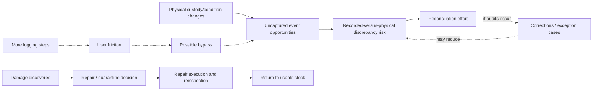

# B2 — Feedback Loops and Mechanism Map

**Model type:** conceptual feedback and stock-flow hypotheses, not a measured system-dynamics model. Every variable below needs operational definition and a measurement source before simulation can be calibrated.

## Stocks (things that accumulate)

- **Usable equipment stock**: physically usable items eligible for borrowing.
- **Items in active custody**: checked out to person/team; some are still usable.
- **Awaiting inspection / damaged**: items needing assessment, quarantine or repair.
- **Outstanding repair cases**: open actions awaiting parts, vendor, approval or return.
- **Unknown/unreconciled assets**: records and physical inventory cannot be matched at an audit point.

These are *conceptual buckets*. A real asset must occupy only one mutually exclusive operational availability category at a time; conditions and custody are tracked as separate attributes, not double-counted.

## Feedback hypotheses

### Loop R1 — Damage/reporting backlogs (reinforcing, **hypothesis**)
1. Some condition changes are not captured at return [reported].
2. The number of assets with **unknown or stale condition** may increase [hypothesis].
3. Later users have less reliable condition information [logical consequence].
4. When discovering damage requires extra effort, users may delay reporting [hypothesis; not verified motivation].
5. Unresolved, poorly documented cases may accumulate [hypothesis].

The reporting-friction links are untested; it is not established that damage is becoming more frequent over time.

### Loop B1 — Repair feedback (balancing, **candidate future mechanism**)
1. A damage report identifies an unusable item.
2. Item is promptly marked unavailable, and a repair/retirement decision is assigned.
3. Repair is executed, followed by usable-condition verification.
4. Item returns to usable stock, reducing the open repair backlog.

This balancing loop only works if decision ownership, budget, external shop capacity and timely status updates are in place. Recording a ticket is not the same as completing a repair.

### Loop R2 — Recording burden vs bypass (reinforcing, **hypothesis to test**)
1. More mandatory logging steps can increase user/guard/captain effort.
2. Increased friction may raise informal bypass frequency.
3. Bypass creates missing records.
4. More missing records can prompt demands for more paperwork.

This is a *risk* when designing the future system, not an observed causal cycle in Alaknanda. Test task times and compliance before imposing new requirements.

### Loop B2 — Inventory reconciliation (balancing, **candidate future mechanism**)
1. A periodic physical count detects item/status discrepancies.
2. An authorized resolver corrects records or creates a missing/damaged case.
3. The known discrepancy backlog decreases.
4. New discrepancies can still arise during unrecorded handovers; periodic audit complements but does not replace event capture.

## Diagrams

**Solid arrows** show workflow relations from reports/design logic; **dashed arrows** represent unvalidated responses or planned interventions. All loop labels are proposals until testing.

## First quantitative model (for B3)

For one asset and a chosen observation window:

- True state: \(S_t = (L_t, C_t, Q_t)\).
- Recorded state: \(\hat S_t = (\hat L_t, \hat C_t, \hat Q_t)\).
- Accountability at independent audit: \(a_i = 1\) iff all three recorded dimensions can be independently verified and agree with contemporaneous physical observations; else \(a_i=0\).
- Strict accountability rate: \(A = (\sum_i a_i)/N\) for a specified eligible sample size \(N\).
- Capture compliance for a *future trial*: \(r = (\text{correctly recorded required events})/(\text{eligible events observed})\).

The relation between compliance \(r\), time since last inspection, and accountability \(A\) is **not known**. A formal event-capture scenario model would require assumptions about each event's probability of updating location, custody and condition separately; simple multiplication can be used as a hypothetical sensitivity model but must not be treated as an empirical law.

## Model validation plan

1. Establish precise item/kit/stock-lot definitions.
2. Collect one permissioned anonymized physical audit to create an accountability denominator.
3. Observe a limited number of consented issue, transfer and return cycles, keeping identities outside the public repo.
4. Test a low-friction return inspection and a kit-manifest workflow as prototypes.
5. If feasible, collect damage-report timestamps and repair stage timestamps; do not fabricate occurrence dates.
