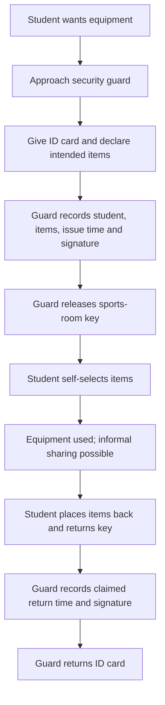
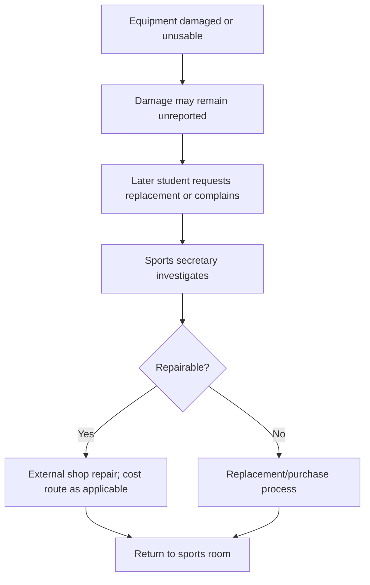
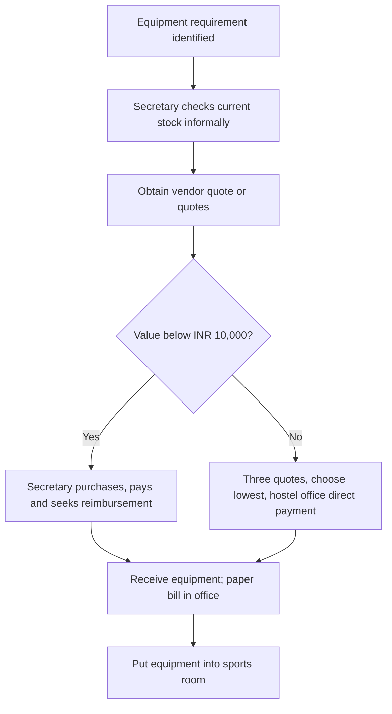

# A1 — Provisional current-state maps

These maps are **research reconstructions from one sports secretary's account**, not validated by guard observation. Detailed A2 maps will follow role and exception clarification.

## A. Key and item access

**Verification gaps:** no check that declared items match actual removal; no individual item-to-borrower continuity when equipment changes hands; no confirmed physical return or condition inspection.

## B. Reported damage and maintenance

**Caution:** Some incidents may instead be directly reported; precise branch frequency unknown. No formal quarantine/inspection state confirmed.

## C. Reported procurement

**Verification needed:** threshold interpretation, approval rules, invoice processing, asset recording, elapsed time and exceptional procurement cases.
