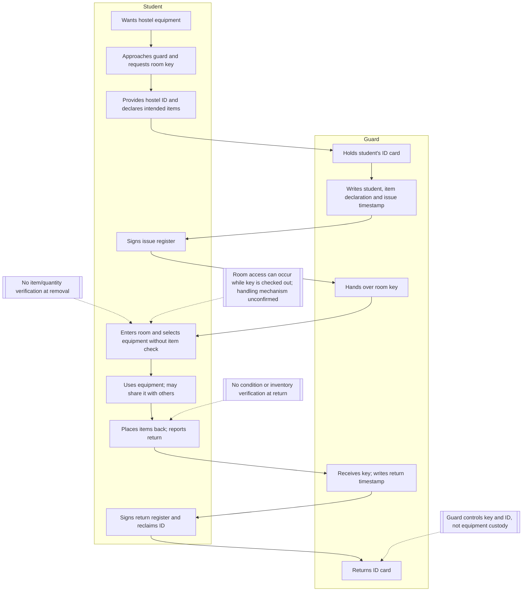
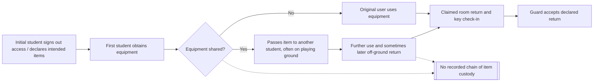
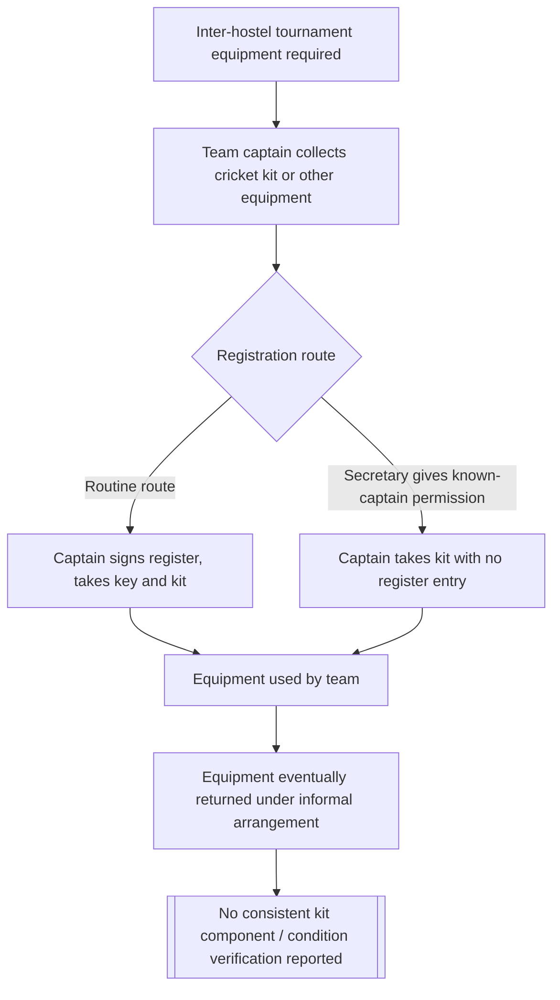
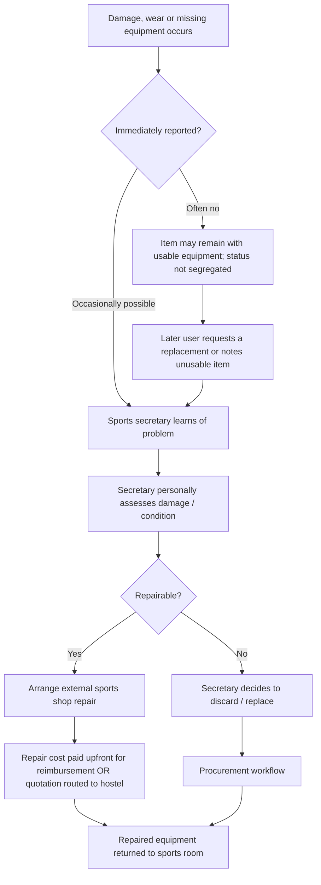
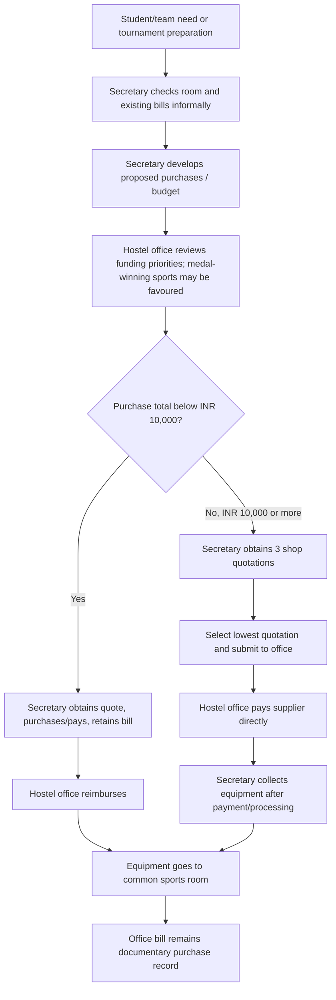

# A2 — Verified-as-reported current-state process maps

**Project:** Beyond the Game | **Site:** Alaknanda Hostel, IIT Madras  
**Source:** Serving hostel sports secretary's firsthand account across two project interviews (A1 and A2); not an independently observed process audit.  
**Method:** Functional decomposition and stakeholder swimlane reconstruction.  
**Version:** A2 v1 | **Status:** Ready for user review; measurement and third-party confirmation pending.

> **Interpretation:** Solid workflow steps are **reported practices**, not demonstrated compliance by every borrower. The diagrams are **current state**, not proposals. The unrecorded paths must be shown explicitly rather than silently assumed away.

## Map 1 — Routine sports-room access, issue and return

**Data captured:** name, roll, room, intended equipment, issue time, return time, signatures at issue/return.  
**Data not captured:** unique item IDs, actual items removed, intermediate handovers, verified return quantity, condition at handover/return, inspection outcome.  
**Access:** 24/7 for hostel residents. **No duration restriction reported.** Key is considered checked out until the same initial student returns it, yet other students can access equipment during that period. The practical mechanics of simultaneous access are *not fully known*.

**Time:** approx. 5 minutes from student room via guard to equipment collection; user's informal estimate, includes travel; registration is perceived as mildly slow. Equipment is reportedly generally easy to locate. This is **not** a timed baseline.

## Map 2 — Informal person-to-person transfer

**Observed-as-reported failure boundary:** The person named in the key register is not necessarily the last person who held or damaged a specific item. This complicates individual damage accountability; it does **not** prove wrongdoing.

## Map 3 — Tournament kit exception

**Reason for exception:** Sports secretary intentionally prioritizes player preparation close to matches, avoiding administrative friction. The team kit may be handled as a bundle. Return responsibility and exception frequency require confirmation. **Do not present this route as a formal written policy.**

## Map 4 — Damage discovery, repair and retirement

**Reported common damage types:** broken cricket bats, loose badminton strings, detached TT rubber; balls more often age out. **Damage timing is unknown**. Repairs may be paid by secretary and reimbursed, or supported by shop quotation and hostel payment; no spending threshold for *independent repair approval* was identified. Secretary makes ultimate discard decision. No quantified repair durations, counts, or failures available.

## Map 5 — Procurement and replenishment

**Threshold and time claims are reported local practice, not verified institutional policy.** Secretary reports office payment may take approximately three working days, and collection around one week on this route. Reported financial prioritization starts with equal treatment of sports, with hostel-office preference for medal-producing sports under budget pressure. There is **no known centralized item/location list beyond bills and knowing items are in the room**. Do not equate an invoice with evidence an item remains usable.

## Information/control boundaries

| Boundary | Known control | What isn't verified or connected |
| --- | --- | --- |
| Guard → initial student | Physical key, ID pledge, signed declaration | Exactly which assets/quantities physically leave |
| Initial student → teammates | Informal permission/sharing | Custody after handover; current borrower |
| Student → room | Key return and claimed item return | Item count, condition, proper storage |
| Damage occurrence → secretary | Often only later complaint | Date, cause, responsible user, severity, repair priority |
| Repair shop → room | Secretary coordinates repair | Systematic return-to-service inspection and status update |
| Hostel funds → stock | Purchase quotes, bills | Reconciled asset register, life-to-date cost and replacement trace |
| Tournament exception → records | Secretary verbal permission | Recorded kit identity, borrower, completion and return |

## Distinguish identified facts from conclusions

**Grounded operational characterization:** Current procedure tracks room-key access and **declared** borrowing; it does not ensure item-level traceability or early condition detection. The tournament exception can bypass even the declared-item register entry.

**Not yet established:** theft/loss rate; true transaction volume; economic cost of failures; number of unusable items; whether most issues are caused by poor custody; whether digital scanning is necessary; whether automated logging saves total effort; whether other hostels follow the identical process.

## Verification needs carried into A3

- Redacted register metadata or aggregated counts and times to estimate traffic, not student identities.
- Item and condition counts (even a small category sample) to quantify status accuracy.
- Small set of actual timed check-outs and returns; separate walking time from writing and physical collection.
- Non-identifying invoice/repair chronology for selected reported damage case(s), especially the bat example.
- Whether key-sharing access and team captain exemptions are common, and how they actually occur.
- Physical workflow permissions and implementation constraints from guard/hostel office before piloting changes.
